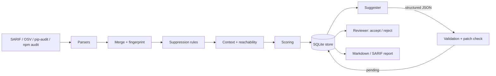

# Vulnscope

**Triage for static-analysis and dependency findings, with model suggestions that a human always reviews.**

Security scanners produce long, noisy lists. Vulnscope reads their reports, merges duplicates
across tools, ranks what is left with a score you can audit, and can ask a language model for a
remediation suggestion. A suggestion is only ever a proposal: it is validated, labelled as
unreviewed, stored as `pending`, and never applied to your code.

> **Scope note.** Vulnscope is built and documented for **public code and public advisory data
> only**. It contains no employer material.

## Status

Implementation and test suite are included. **Benchmarks and real-world evaluation are not yet
published**, and the code has not been published to PyPI. See [Limitations](#limitations).

## Features

| Area | What it does |
| --- | --- |
| Ingest | SARIF 2.1.0 (for example Semgrep), OSV-Scanner JSON, `pip-audit` JSON, `npm audit` JSON |
| Normalise | One `Finding` model, severity bands, CVSS when the tool supplies it |
| Merge | Same rule and position from two tools collapse; dependency findings merge through shared advisory aliases |
| Fingerprint | Stable ids that survive line-number drift; ordinal suffix for repeated hits |
| Context | Source excerpt around a finding, confined to the project root; dependency path for npm |
| Reachability | Python import graph from entry points gives *reachable / unreachable / unknown* |
| Score | `min(10, base x reachability factor + exploit bonus)`, with every term returned |
| Suggest | Pluggable provider (Ollama, OpenAI-compatible) returning validated JSON |
| Guardrails | Patch must touch only the flagged file and apply cleanly; nothing is applied automatically |
| Review | SQLite-backed `pending` / `accepted` / `rejected` workflow with a required reviewer name |
| Learn | Repeated false-positive verdicts produce *proposed* suppression rules that a person must adopt |
| Report | Markdown and SARIF output |

## Architecture



More detail is in [docs/ARCHITECTURE.md](docs/ARCHITECTURE.md). Design decisions are recorded in
[docs/adr](docs/adr).

## Quick start

```bash
pip install -e ".[dev]"

# 1. Ingest reports produced by your own scanners
vulnscope scan semgrep.sarif osv.json --root . --known-exploited exploited.txt

# 2. Ask a local model for suggestions on the top findings (stored as pending)
vulnscope triage --provider ollama --model <model-name> --top 5

# 3. A person decides
vulnscope review list --state pending
vulnscope review accept 1 --reviewer "Your Name" --note "verified against the advisory"

# 4. Report
vulnscope report --format markdown --output triage.md
vulnscope report --format sarif --output triage.sarif
```

`--provider openai` sends code excerpts to a remote service, so it is refused unless you pass
`--allow-remote`. API keys are read from the environment (see `.env.example`).

### Scoring

```text
final = min(10, base * reachability_factor + exploit_bonus)

base                CVSS when provided, else critical 10 / high 7.5 / medium 5 / low 2.5 / info 0.5
reachability_factor reachable 1.0 / unknown 0.8 / unreachable 0.4
exploit_bonus       +2.0 when an advisory id is in the file given to --known-exploited
priority            P1 >= 8, P2 >= 6, P3 >= 3.5, otherwise P4
```

The weights are a documented starting point, not a calibrated model.

### False-positive learning

```bash
vulnscope review false-positive <fingerprint> --reviewer "Your Name"
vulnscope suppress propose --min-count 3
vulnscope suppress adopt <rule-id> "tests/*" --reason "fixtures contain fake keys"
```

A rule is proposed only when one rule was marked a false positive at least `min-count` times in a
directory and never marked a true positive there. Proposals do nothing until adopted.

### GitHub Actions

```yaml
- run: pip install vulnscope   # or install from a checkout
- run: vulnscope --db triage.db scan semgrep.sarif osv.json --root .
- run: vulnscope --db triage.db report --format sarif --output vulnscope.sarif
- uses: github/codeql-action/upload-sarif@v3
  with:
    sarif_file: vulnscope.sarif
```

Run `triage` locally rather than in CI unless you have decided that sending excerpts to your
chosen provider is acceptable.

## Project layout

```text
src/vulnscope/
  models.py        normalised Finding, Suggestion and score models
  parsers.py       SARIF, OSV, pip-audit and npm audit
  dedupe.py        merging and fingerprints
  context.py       safe code excerpts
  reachability.py  import-graph heuristic
  scoring.py       transparent scoring
  llm.py           providers (Ollama, OpenAI-compatible, deterministic fake for tests)
  remediation.py   prompt, validation and retry
  patch_check.py   diff guardrails
  review.py        state machine
  store.py         SQLite store
  suppression.py   proposed and adopted rules
  report.py        Markdown and SARIF
  cli.py           command line
tests/             pytest suite using hand-written sample reports
docs/              architecture and decision records
```

## Limitations

- **Heuristic reachability.** The import graph ignores dynamic imports, framework wiring and call
  graphs. A *reachable* result is not proof of exploitability, and *unreachable* is not proof of
  safety. Only Python is analysed; other languages report *unknown*.
- **Severity inputs vary.** `pip-audit` reports no severity, so those findings default to medium.
  OSV vector strings are not converted to numeric CVSS; only numeric scores and the database
  severity label are used.
- **Model output is untrusted.** Suggestions are validated for shape and patch safety, not for
  correctness. The `confidence` value is self-reported and not calibrated.
- **Prompt injection is mitigated, not eliminated.** Excerpts are treated as data and truncated,
  and patches are constrained, but a determined payload could still influence an explanation.
- **Fingerprints trade precision for stability.** Identical rule, file and message hits are
  distinguished only by their order in the file.
- **Not evaluated.** There is no measured precision, recall or time-saved figure, and none is claimed.
- **Test inputs are hand-written samples**, not captured scanner output.
- The test suite and CI configuration have not yet been executed in a clean environment.

## Roadmap

- Evaluate on public repositories with published SARIF and record the method and results.
- Convert CVSS vectors to numeric scores.
- Reachability for JavaScript and Java.
- Optional EPSS and known-exploited feed importers.
- Package release and a container image.

## Development

```bash
make install   # editable install with dev tools
make check     # ruff, mypy and pytest
```

## License

MIT, see [LICENSE](LICENSE).
