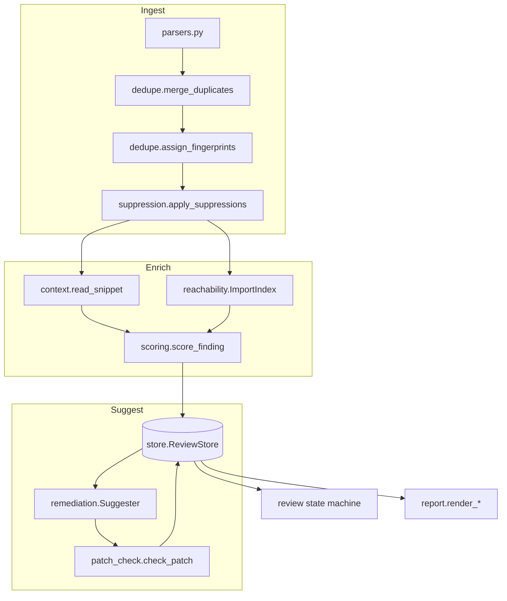
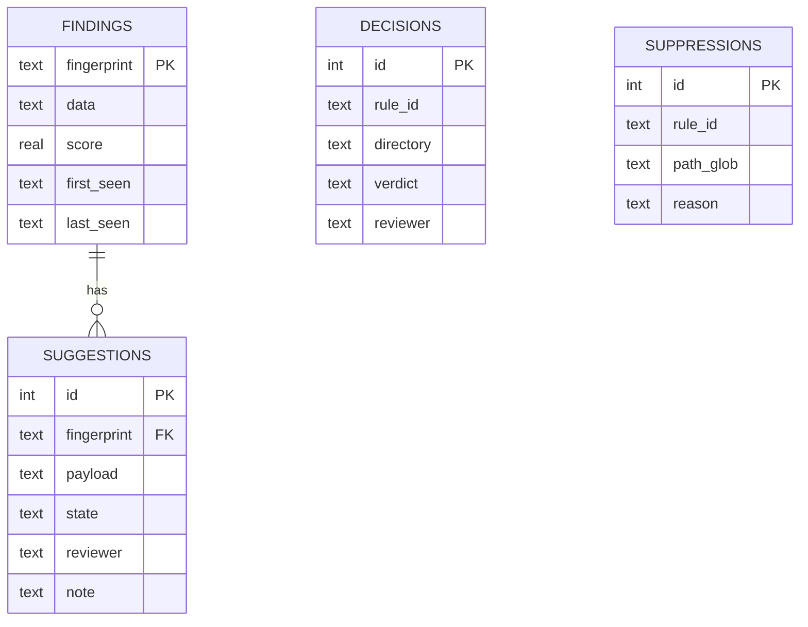

# Architecture

Vulnscope is a pipeline with a persistence boundary. Everything before the store is a pure
function of its inputs; everything after it involves a person or a model.

## Components

| Module | Responsibility | Failure behaviour |
| --- | --- | --- |
| `parsers` | Convert four formats to `Finding` | Raises `ParseError` on malformed input; never returns partial output |
| `dedupe` | Merge across tools, compute fingerprints | Pure; keeps the higher severity |
| `context` | Read lines around a finding | Returns `None` for paths outside the root, missing or oversized files |
| `reachability` | Import graph and entry points | Returns `unknown` when it cannot decide |
| `scoring` | Combine severity, reachability, exploit list | Returns every term in `ScoreBreakdown` |
| `llm` | HTTP providers and a fake | Raises `LLMError`; refuses non-HTTP URLs |
| `remediation` | Prompt, parse, validate, retry once | Raises `SuggestionRejected` after the attempt limit |
| `patch_check` | Validate a unified diff in memory | Returns a list of problems; never writes files |
| `review` / `store` | State machine and SQLite | Rejects invalid transitions; requires a reviewer name |
| `suppression` | Propose and apply rules | Proposes only; adoption needs a written reason |
| `report` | Markdown and SARIF | Labels unreviewed model output |

## Data model

## Trust boundaries

1. **Scanner reports** are untrusted input. Parsers validate structure, and paths are confined to
   the project root before any file is read.
2. **Model output** is untrusted. It must parse as the required JSON object, and any patch must
   pass `check_patch` before it is even stored.
3. **Reviewer identity** is a name supplied on the command line. It is an audit label, not
   authentication.
4. **Remote providers** receive code excerpts, so they require an explicit flag.

## Extension points

- Add a provider by implementing `LLMProvider.complete(system, prompt)`.
- Add an input format by writing a parser that returns `list[Finding]` and registering it in
  `parse_document`.
- Add a language for reachability by implementing the same `file_reachability` and
  `package_reachability` contract.
